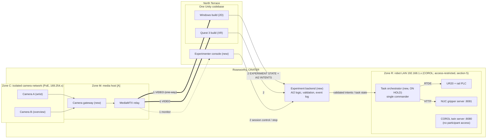

# Phase 2 provisional system architecture

**Status:** **provisional**, approved by the researcher on 5 November 2026 as the planning baseline. It is not a design freeze.

**Sources:**
- [Task 04A streaming audit](../audits/Phase2_Task04A_Streaming_Architecture_Audit.md)
- [COROL integration addendum](../audits/Phase2_Task04A_Addendum_COROL_Integration_Audit.md)
- [camera checkpoint](../../camera_validation/CAMERA_DISCOVERY_2026-11-03.md) §11–13

**Implementation state:**
- The localhost streaming proof of concept ([streaming_poc/](../../streaming_poc/README.md), Task 04B) is **complete** (closed 5 Nov at gate G1; synthetic frames, Python reference receiver).
- **No robot-control, orchestrator, backend or Unity code exists.** Robot-control work is on hold by decision (§1, D2).

**Labels used throughout:**
- **[V]** verified (measured, or read in source)
- **[A]** assumption, not yet verified
- **[R]** requirement, proposed and awaiting CRATER/AIML or IT review

---

## 1. Decisions recorded (researcher, 5 Nov 2026)

| ID | Decision |
|---|---|
| D1 | The separation between the **task orchestrator**, **experiment backend**, **video pipeline** and **Unity participant interfaces** is the provisional architecture |
| D2 | **No robot-control functionality is implemented or run yet.** COROL's lack of authentication is a significant concern. The network-isolation and access-control requirements (§5) go to the authorised CRATER/AIML team for review. The existing robot server is not to be tested or accessed |
| D3 | Task 04B preparation approved: separate venv, PyAV, the official MediaMTX Windows release, synthetic stereo frames, wall-clock timestamps, host IDs, frame-age and freeze events, COROL's ports avoided |
| D4 | The primary architecture stays **one Unity codebase** targeting **Windows (2D condition)** and **Quest 3 (XR condition)**. The **media receiver implementation stays flexible** behind a common interface |
| D5 | MediaMTX runs **localhost-only** for Task 04B. Stop before launching it or running streaming tests (review gate) |
| D6 | The questions for the CRATER/AIML team are drafted as a document and **not sent** |
| D7 | The architecture documentation reflects this direction, with unverified assumptions marked |

---

## 2. Components and responsibilities

| Component | Location | Responsibility | State |
|---|---|---|---|
| Camera A (OAK-D Pro PoE AF, wrist) and Camera B (OAK-D Pro W PoE, overview) | CRATER, isolated PoE network | Rectified stereo, on-device H.264 per eye [A: on-device encoding of rectified output untested] | Validated for capture and rectification (Task 03) [V] |
| **Camera gateway** (new) | CRATER host on the camera network | DepthAI 3.11 pipelines (auto-calibration OFF, IR off), SEI frame metadata, publishing to the relay; no re-encoding | Stand-in prepared offline (`publish_synthetic.py`) |
| **Media relay** (MediaMTX) | CRATER (host to be decided [A]) | RTSP(S) distribution to participant clients and the experimenter monitor; optional recording | Localhost config prepared; not run |
| **Unity participant client**: one codebase, two builds | North Terrace | 2D (Windows) and XR (Quest 3) conditions; the same AI2 UI, logging and image handling; video through `IStereoVideoSource` | Not started; Unity 6000.3.28f1 installed; Task 05 plan awaiting approval |
| **Experiment backend** (new) | CRATER or university server [A] | Sessions, trials, AI2 decision logic, intent validation, ACK/NACK, the authoritative event log, clock-offset probes | Not started |
| **Task orchestrator** (new) | CRATER robot LAN | The only commander of UR20, rail and gripper; step-based task state machine; rehearsal in simulation via COROL `robot_sim` | **On hold (D2)** |
| COROL twin server, `robot.py`, NUC gripper server (existing) | CRATER robot LAN | Robot library and digital twin owned by the AIML team | Read-only reference for us [V] |
| **Experimenter console** (new) | North Terrace (and/or CRATER) | Session control, approve/hold/stop, health, video monitor | Not started |

### Media receiver flexibility (D4)

`IStereoVideoSource` is the only thing the Unity experiment logic sees. It delivers:
- per-eye textures;
- the frame metadata (camera, eye, sequence number, capture times);
- link state;
- freeze and frame-age events.

Candidate back-ends, any of which may be swapped in without touching the experiment logic:

| Back-end | Platform | Status |
|---|---|---|
| FFmpeg/libavcodec native plugin | Windows | Primary candidate [A] |
| rtsp-client-android + low-latency MediaCodec | Quest 3 | Primary candidate [A] |
| AndroidX Media3 RTSP | Quest 3 | Alternative (buffers more) |
| GStreamer | Both | Alternative (heavier integration) |
| AVPro Video | Both | Commercial alternative |
| JPEG-over-TCP (protocol v2) | Both | **Fallback.** Switched for **both** conditions together, so they stay matched |

---

## 3. Architecture diagram

Path 3 (robot control) is the `BE → ORCH → UR20/NUC` chain and never leaves zone R/CRATER. The zones are proposed trust boundaries [R]. The real network topology is unknown [A].

---

## 4. Communication paths (kept separate)

| # | Path | Direction | Transport (provisional) | Carries | Never carries |
|---|---|---|---|---|---|
| 1 | **Video** | CRATER → clients | RTSP over TCP from MediaMTX (RTSPS across sites) [A] | H.264 per eye plus SEI metadata (camera, eye, sequence number, device / monotonic / UTC capture times, host ID, session/trial, config ID) | Commands, task state, correctness cues |
| 2 | **Experimental state and intents** | Clients ↔ backend | Authenticated WebSocket (or HTTPS + SSE), JSON [A] | Decision prompts, task phase, participant intents (allow / inspect / retry / bounded correction), ACK/NACK with command IDs, freeze and frame-age reports, clock probes | Joint angles, poses, speeds, robot addresses |
| 3 | **Robot control** | Backend → orchestrator → UR20/rail/NUC | Local to CRATER: RTDE (ur_rtde) and HTTP to the NUC [V for COROL's protocols] | Pre-validated task steps; bounded offsets | Any traffic originating outside CRATER; participant traffic of any kind |

---

## 5. Network-isolation and access-control requirements (for CRATER/AIML and IT review)

**Why:**
- COROL's twin server (port 8080) and the NUC gripper server (port 8081) accept **unauthenticated** HTTP from any host that can reach them.
- Between them, they expose arm motion, jogging, rail moves, stops, robot power-off, protective-stop unlock, TCP changes and gripper commands [V, COROL source].
- This is reasonable for a single-user lab tool. It is **not acceptable on any network that participant devices, the university network or another campus can reach.**

All items below are **proposed [R]**. They need review by the authorised CRATER/AIML team (and university IT where noted) before any robot integration work starts. None has been implemented or tested, and no COROL service has been accessed.

### 5.1 Network isolation

| ID | Requirement |
|---|---|
| R-NET-1 | The robot LAN (zone R: UR20, UR3e, rail PLC, NUC, twin server) is **not routable** from the university network, from North Terrace, from VPN clients or from participant devices. This is enforced by network controls (VLAN, ACL or firewall), **not** by obscurity or by "nobody knows the address" |
| R-NET-2 | Participant devices (Windows PC, Quest 3) and the experimenter console **never** join the robot LAN or the camera network |
| R-NET-3 | The camera network (zone C) stays isolated. Only the camera gateway host is attached to it, and that host does not route or bridge between zone C and any other network |
| R-NET-4 | Only explicitly listed flows cross zone boundaries: (a) video from the media relay to the clients; (b) path 2 from the clients to the backend; (c) the backend to the orchestrator on one port. Nothing else is opened |
| R-NET-5 | Cross-campus flows (Roseworthy ↔ North Terrace) use encrypted transport: RTSPS or TLS for video, TLS for path 2. The route (direct, university VPN or another option) is decided with university IT [A] |
| R-NET-6 | Host firewalls default to deny inbound on the gateway, relay, backend and orchestrator hosts, with allow rules only for the flows in R-NET-4. Changes are made only by authorised staff (this project changes no firewall settings itself) |
| R-NET-7 | The COROL ports (8080, 8081) and UR controller ports (29999, 30001–30004) are never published outside zone R |

### 5.2 Access control

| ID | Requirement |
|---|---|
| R-AC-1 | **Single commander:** during a trial, only the task orchestrator holds a UR20 control link. A documented procedure, and ideally a technical lock, prevents the COROL viewer's Execute/Jog/Dashboard functions, `check_robot_link.py` and other tools from commanding the cell at the same time. The UR20's measured limit of 5 RTDE clients is part of this check |
| R-AC-2 | Participants can only submit **intents from a closed set**. They cannot submit motion parameters. The backend validates the schema, session token, current decision point, one decision per point, rate limits and correction bounds, and rejects (NACKs) and logs everything else |
| R-AC-3 | Path 2 is authenticated: per-session tokens issued by the experimenter console, expiring at session end. The experimenter role (start, approve, hold, stop) is separate from the participant role |
| R-AC-4 | Media relay: publishing is allowed only from the gateway (localhost or zone M). Clients get read-only access with credentials; there is no anonymous access across sites |
| R-AC-5 | Robot power-off, protective-stop unlock, TCP changes and freedrive are **not reachable** through any Phase 2 interface. They stay at the pendant, with AIML staff |
| R-AC-6 | Orchestrator motion limits (speed, force, workspace, rail zones, divider interlock, correction bounds) are set and signed off by the AIML team. They are enforced in the orchestrator, independently of the backend |
| R-AC-7 | Physical supervision: an authorised operator with E-stop access is present whenever the robot can move. Software stops (COROL `/api/stop`) are **not safety-rated** [V, COROL source] and do not replace the E-stop |
| R-AC-8 | Loss of path 2 or of the backend makes the orchestrator finish the current atomic step and hold. It never continues on its own. The RTDE watchdog policy is an AIML decision [A] |
| R-AC-9 | Every request, decision, ACK/NACK, robot step and stop is written to the append-only event log with UTC and monotonic timestamps and the host ID |

### 5.3 Until reviewed

- No Phase 2 component connects to the robot LAN.
- No COROL service is started, tested or accessed.
- COROL is used only as read-only source code.
- Streaming work stays localhost-only (Task 04B).

---

## 6. Assumptions register

| # | Assumption | Status | Resolved by |
|---|---|---|---|
| A1 | On-device H.264 encoding of `StereoDepth` rectified output works at 1280 × 800, 20 fps per eye on both cameras | Unverified | Hardware test after Task 04B |
| A2 | On-device encoding cuts the PoE load to about 10–20 Mbit/s per camera (raw measured: about 328 Mbit/s) | Estimate | Hardware test |
| A3 | SEI user data survives MediaMTX relaying (RTSP in, RTSP out) | Unverified. It survives an MPEG-TS file round trip [V, offline test] | Task 04B G1.7 |
| A4 | Frame age on localhost meets median ≤ 60 ms and p95 ≤ 100 ms with libx264 veryfast/zerolatency | Unverified | Task 04B G1.3 |
| A5 | A Quest 3 MediaCodec back-end can deliver two 1280 × 800 streams to Unity textures without dropped XR frames | Unverified | Gate G3 |
| A6 | A Windows FFmpeg back-end in Unity meets the same G1 metrics | Unverified | Gate G2 |
| A7 | A cross-campus route exists with enough bandwidth (about 20–40 Mbit/s for two cameras) and acceptable jitter | Unknown | University IT |
| A8 | Clocks can be synchronised (NTP) across CRATER hosts and the clients, well enough for UTC frame age | Unknown | IT / AIML |
| A9 | A host at CRATER may be attached to the camera network and to a network that reaches North Terrace | Unknown | AIML / IT |
| A10 | The AIML team will allow an external orchestrator to command the UR20, rail and gripper under supervision | Unknown | AIML (questions document) |
| A11 | COROL's `robot.py` on `albert-phase2` @ `55cfb61` matches the version deployed on the cell | Unknown | AIML |
| A12 | Unity with Windows and Android build support can be installed | **Partly resolved (5 Nov):** Unity 6000.3.28f1 is installed; a URP project opens and Play Mode works. Android Build Support and Quest deployment are unverified | Researcher (Quest check later) |
| A13 | The MediaMTX exe (unsigned) runs on this managed laptop without Defender/AppLocker intervention, and binding to 127.0.0.1 raises no firewall prompt | Unverified | Task 04B launch (after approval) |
| A14 | The frame-age, freeze and integrity behaviour of the Python reference receiver carries over to the Unity back-ends | Assumption | G2/G3 |

---

## 7. Gates (unchanged from the Task 04A audit §7, with the review points added)

1. **Review gate (now):**
   - the MediaMTX localhost config;
   - the Task 04B scripts and offline test results;
   - the questions document.

   Then, on approval: a smoke test, followed by the G1 run.
2. **G1:** offline proof of concept on localhost (Python reference receiver).
3. **G2:** Unity Windows build. Unity 6000.3.28f1 is installed (A12); Task 05 plans the first milestone.
4. **G3:** Quest 3 build. Proceeds only after G2.
5. **G4:** live cameras, then cross-campus. Needs A7–A9.
6. **Robot integration:** only after the §5 requirements are reviewed and the AIML questions are answered. Not scheduled.
