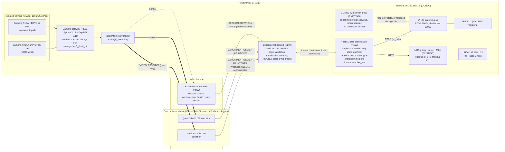

# Task 04A addendum: COROL integration audit

**Date:** 5 November 2026. **Scope:** source-code inspection only.

**Repository inspected:**
- Path: `C:\Users\a1920234\Documents\Phase 2_COROL\lab_digital_twin`
- Branch: `albert-phase2`
- HEAD: `55cfb61` ("Add the pick-and-place script and its pose file", Albert Rajkumar, 5 Oct 2026)
- Remote: `gitlab.aiml.team/abdulmohsi.jawaid/lab_digital_twin`

**Method:**
- Files were read with editor and search tools. Git history was read with `git --no-optional-locks log`, `rev-parse` and `ls-files` (read-only).
- No COROL module was executed or imported, no server was launched, and no robot IP or port was contacted or scanned.
- Nothing in the COROL repository or its Git configuration was changed.
- The validated camera software and the Side Quest repositories were not touched.

**Evidence labels** (as in the [Task 04A audit](Phase2_Task04A_Streaming_Architecture_Audit.md)):
- **[V]** verified in source
- **[D]** stated in COROL documentation or comments, not verified in code behaviour
- **[I]** inference
- **[U]** unknown, needs the CRATER/AIML team

---

## 1. Summary

1. **COROL is a browser-based digital twin plus a robot-control library, not a task or experiment system.**
   - A FastAPI server (`server.py`, port 8080) serves a three.js viewer. It bridges to the real robots through `robot.py`, which uses `ur_rtde` over RTDE plus a PLC register bridge for the rail.
   - It also simulates the cell (`sim.py`, `robot_sim.py`).
   - Every interface is **HTTP/JSON request–response, polled by clients**. There are no WebSockets, ROS, MQTT or gRPC [V].
2. **The Phase 2 task exists only as a simulation script.**
   - `Albert/albert_lantern_regolight_pick_place_sim.py` runs six pick-and-places across the regolight and lunar-lantern sites. It reads poses from `pick_place_poses.json` and applies tolerance checks and a rail/screen interlock.
   - It is marked **"SIMULATION ONLY — DO NOT CHANGE THE IMPORT TO robot.py"**.
   - Every slot except the lantern drop is a **placeholder** computed from a layout that has not been checked against the lab [V].
   - It runs start to finish, or aborts on the first failure. **There is no pause, decision point, retry, correction or external command interface** [V].
3. **Commanding capability is real and well engineered, but is not designed for remote participants.**
   - The server exposes motion (`/api/execute`, `/api/jog`, `/api/jog/track`), stops, dashboard power-off and protective-stop unlock, gripper pass-through and setting the TCP. It does so to **anyone on the LAN, with no authentication** ("single-user by design") [V][D].
   - Participant clients must therefore **never** reach `server.py` or the gripper server directly.
4. **There is no persistent event log.** Timestamps exist (controller timestamp, sample age, server wall clock, sim time), but logging goes to stdout only (`print`) on the twin server, and to Python `logging` on the gripper NUC [V].
5. **No conflict with the proposed video architecture.**
   - This branch contains no real-camera streaming. The Basler/EVK4 `camera_lib` and the vision pipeline are referenced in `requirements.txt` but not present.
   - Ports 8080/8081 do not clash with MediaMTX's defaults.
   - The robot LAN (192.168.1.x) is separate from the camera network (169.254.x) [V][I].
   - **Task 04B can proceed unchanged**, with three small additions to its metadata and logging design (§10).
6. **Main architectural gap:** a new **Phase 2 task orchestrator** is needed, and it must be the **single commanding process**. It would run the task as discrete validated steps, stop at AI2 decision points, accept only whitelisted intents from an experiment backend, and log every event. It can reuse COROL's `robot.py`, its tolerance-checked move helpers and the twin's identical simulation API, so every sequence can be dry-run in the twin before hardware (§7–9).

---

## 2. Repository map (relevant components)

| Component | File(s) | Role | Status |
|---|---|---|---|
| Twin server | `digital_twin/server.py` (FastAPI, 0.0.0.0:8080) | Viewer, models, live RTDE sync, real-robot execute/jog/stop/dashboard, sim API, gripper pass-through, virtual-camera relay | Implemented [V] |
| Robot library | `robot.py` (`Robot`, `Track`; `ur_rtde` ≥ 1.6.5 + vendored UR `rtde_client`) | One object per arm: state stream, control link, movej/movel/paths, speedj/l, servoj, stop, waits, watchdog, TCP, payload, freedrive, IK/FK; track via PLC registers | Implemented [V] |
| Track control program | `rtde_control_track.script` (generated for ur_rtde 1.6.5; the generator `make_track_control_script.py` is **not in this branch**) | ur_rtde control script plus a bridge thread copying input registers 42–46 to the PLC's output registers | Implemented, generator missing [V] |
| Simulator | `sim.py`, `robot_sim.py` (same API as `robot.py`, standard library only) | URScript-subset interpreter, trapezoidal timing, track semantics, simulated gripper; state saved to `models/sim_state.json` | Implemented [V] |
| Gripper server | `gripper/robotiq/server/gripper_server.py` (FastAPI :8081 on the NUC; Modbus RTU over USB-RS485) | Owns the serial port; `/health /status /activate /open /close /goto /stop`; reconnect with backoff; systemd unit | Implemented [V]; NUC address is a **placeholder** (`config.json` 192.168.1.51; README example .50) |
| Gripper client | `gripper/robotiq/client/robotiq_client.py` | `RobotiqGripper` (open/close/goto/stop/activate/status/health/wait); `MoveResult` with `object_detected` | Implemented [V] |
| Phase 2 task (sim) | `Albert/albert_lantern_regolight_pick_place_sim.py`, `Albert/pick_place_poses.json`, `Albert/albert_tcp_pick_place_checkpoint_sim.py` | Checkpoint-style pick and place with verification and interlocks | **Simulation only; placeholder poses** [V] |
| Phase 2 layout | `client_config_albert_phase2.json` → `albert_phase2_setup_lite.glb` | Screens, boxes, formworks, **two tripods with camera models**, a human; per-part colliders | Config present; **GLB not in the repository** (`*.glb` ignored apart from the robot models); placement provisional [V][D] |
| Link diagnostics | `check_robot_link.py` | Layered checks (TCP ports → dashboard → RTDE → track feedback → control → track IO → jog → track move); layers 4+ change robot state | Implemented; **not to be run by us** [V] |
| Virtual camera | `camera.py`, `event_camera.py`, `/api/camera/frame` and `/latest` | The browser renders **one** active virtual camera and POSTs JPEG/PNG frames (~10 fps) to a single-slot buffer | Implemented [V] |
| Legacy | `robot_urscript.py`, `Deprecated/`, `examples/`, `robot_football.html` | Earlier URScript library, old sims, demos | Reference only |
| Referenced but absent | `proximity_planner/`, `camera_lib/basler`, `camera_lib/evk4`, `twin_proximity_real.py`, `ur_kinematics.py`, `requirements-torch.txt` | Vision and planning stack named in `requirements.txt` and comments | **Not in this branch** [V] |

**Entry points:**
- `python server.py`: twin and real-robot bridge.
- `python gripper_server.py`: on the NUC, via the systemd unit.
- `python Albert/albert_lantern_regolight_pick_place_sim.py`: needs the twin running with Remote mode ON.
- `check_robot_link.py`, the examples and scripts written by users against `robot` / `robot_sim`.

---

## 3. Communication protocols

| Link | Protocol | Endpoint | Notes |
|---|---|---|---|
| Viewer and scripts ↔ twin server | HTTP/JSON (FastAPI), **polling** | `:8080/api/*` | No auth, no TLS, CORS not configured. The viewer polls `/api/sync/live`, `/api/sim/trajectory` (250 ms) and `/api/plots/rev` [V] |
| Twin server / `robot.py` ↔ UR controllers | **RTDE** (TCP 30004) via ur_rtde: receive interface (state) plus control interface (uploads a control program and drives it through registers, upper-range registers 24–47) | UR20 `192.168.1.11`, UR3e `192.168.1.13` | **A UR controller serves at most 5 simultaneous RTDE clients (measured, per comments).** One `Robot` uses 1 (state) + 1 (track side stream, UR20 only) + 1 (control) [V][D] |
| Rail (track) | PLC on the UR20's fieldbus; reached through **robot output registers** written by the bridge thread in the control program | float regs 0–3 (p/v/a/d), bool 8 = GO (rising edge latches), bool 0 = FAULT (only interrupt), bool 1–3 = enables; feedback on input doubles 0/1 | **Moves are atomic and cannot be overridden; a trigger during a move is silently lost.** `robot.py` predicts each move's duration and raises `TrackBusy` [V][D] |
| Dashboard | UR Dashboard Server, TCP 29999, text | — | The server exposes only `power off` and `unlock protective stop` (allow-list) [V] |
| URScript realtime | TCP 30003 | — | Not used by `robot.py` (legacy `robot_urscript.py` only). Any other tool writing a script there kills ur_rtde's program, which is then re-uploaded [D] |
| Gripper | HTTP/JSON on the NUC `:8081` → Modbus RTU (RS485, 115200, slave 9) | `config.json` `gripper.url` (placeholder) | The twin server proxies `/api/gripper/*`, so only the server needs a route to the NUC [V] |
| Virtual camera | HTTP POST of JPEG/PNG with `x-*` headers; GET latest | `/api/camera/frame`, `/api/camera/latest` | One slot; latest frame wins; `x-seq`, `x-sim-time`, `x-age` [V] |

---

## 4. Representation of commands, state, acknowledgements and errors

**Commands:**
- `/api/execute` takes `{ur20|ur3e: {q_deg[6], speed_deg, track?: {p_mm, v_mm_s}}}` and sends a **non-blocking** `movej` (plus a track move). The reply means "sent", **not "arrived"**: `{"sent": true, "speed_rad_s", "track"}` [V].
- Jogging uses a 100 ms lease renewal with a server-side dead-man at 350 ms; it requires live sync.
- Track jogs are discrete steps of at most 250 mm.
- In code, `Robot.movej/movel(wait=True)` blocks until the controller reports completion. The Albert helpers add `wait_until_moving`, `wait_until_done` and a post-move tolerance check [V].

**HTTP status codes (the server's error model):**

| Code | Meaning |
|---|---|
| 200 | OK |
| 409 | Conflict: track busy, live sync off, no fresh track position, or sim ownership |
| 400 / 404 / 422 | Bad request |
| 500 | Controller refused (`CommandRefused`: protective stop, unpowered, Local mode) |
| 502 / 503 / 504 | Unreachable |

The typed library exceptions are `CommandRefused`, `TrackBusy`, `RTDEStreamStalled`, `NotConnected`, `ScriptVersionMismatch`, `ConnectionError` and `TimeoutError` from waits [V].

**Status:**
- `/api/sync/live` returns, per robot: `status` (idle/connecting/ok/reconnecting/stopped), `error`, `updated` (server wall clock), `age_s`, `reconnects`, `q_rad/q_deg`, `tcp_pose`, `track_mm`, `track_age_s`, `track_error`, `safety_mode`, `robot_mode` [V].
- `Robot.status()` returns `{ready, robot_mode, safety_mode, runtime_state, why}` [V].
- The gripper `/health` returns `connected`, `state`, `error`, `status_age_s` and a decoded status (position, `object_detected`, fault) [V].

**Task state:** none on the server. In the Albert script, progress is console `print` lines plus a `(label, seconds)` timing list. Failure is a `CheckpointFailed` or `TimeoutError` that aborts the run and calls `ur20.close()`. The result is PASS/FAIL and the exit code [V].

**Acknowledgement model:** synchronous HTTP replies only. There are no command IDs, no idempotency keys and no asynchronous completion events. Completion must be inferred by polling state [V].

---

## 5. UR20, UR3e, rail and gripper: implemented against placeholder

| Item | Implemented | Placeholder / unverified |
|---|---|---|
| **UR20** (192.168.1.11, on carriage) | Full motion library; live sync; jog with dead-man; execute; stop; set TCP; dashboard power-off and protective-stop unlock; optional RTDE watchdog (off by default) [V] | All Phase 2 task poses except the lantern drop [V]; TCP 0.1946 m measured from the mesh, and the controller's TCP must be set to match [D]; whether the AIML team permits external commanding [U] |
| **UR3e** (192.168.1.13) | Same library; live sync; execute/jog [V] | **No Phase 2 role** in this branch; base pose in the twin is a provisional default unless `models/calibration.json` exists [V]. Not needed for Phase 2 unless the AIML team says otherwise [I] |
| **Rail** (9.4 m, PLC) | Atomic moves, duration prediction, `TrackBusy` interlock, fault-pulse stop and re-arm, feedback side stream [V] | **Travel to be confirmed against the machine** (code: "CONFIRM THE REAL TRAVEL", 9400 against an older 9700) [D]; `init()` pulses the fault (stops the track) [V] |
| **Screen interlock** | In the Albert sim script only: the rail crosses `divider_mm` = 4700 only with the arm upright [V] | Not enforced by `server.py` or `robot.py`. Site boundaries and the divider position are unverified [V][U] |
| **Gripper** (Robotiq 2F-140) | NUC daemon with reconnect and auto-activation; client; twin pass-through; simulated twin gripper [V] | NUC URL placeholder; `opening_mm` is nominal; grip/release openings (60/110 mm and 40/100 mm) are unvalidated [V][D] |
| **Collisions** | Viewer flags contacts (red boxes, counter) against per-part colliders [V] | **Flagged, not prevented; scripts are not told** [D]. Layout GLB placement provisional |
| **Stops** | `/api/stop` (track fault plus arm stop, no locks), `/api/stop/{robot}` [V] | Explicitly **not safety-rated** and no substitute for the E-stop [D] |

---

## 6. Digital-twin communication: reuse in Unity

| Asset | Reusable? | How | Caution |
|---|---|---|---|
| Robot state feed (`/api/sync/live`) | Yes, read-only, **through our backend** | The backend polls it (or reads `robot.py` state directly) and republishes the joint angles and track position | Server `updated` is wall clock, not capture time; 10 Hz; flagged stale on drops |
| Robot GLBs (`ur20.glb` 46 MB, `ur3e.glb` 55 MB, `robotiq_2f140.glb` 11 MB) | Probably | Import into Unity with a glTF importer (e.g. glTFast). Node naming NAUO1–8; angle mapping documented (`q_ur = SIGN·q_rig + OFFSET`) | Large and need decimation for Quest; **licence and redistribution of the UR/Robotiq meshes to be confirmed** [U] |
| Phase 2 layout GLB | Possibly | Same importer | Not in the repository; placement provisional |
| Virtual camera relay | **Not for the participant video path** | Single slot, ~10 fps JPEG via browser rendering | Could later render a **synthetic stereo pair** for development, but only one camera can be active at a time [V] |
| Sim + `robot_sim` API | **Yes: key reuse** | The orchestrator runs the same step code against `robot_sim` (dry run or rehearsal) and then `robot` | Sim cannot refuse moves for robot-side reasons and does not simulate speedj/speedl [D] |

**Research-design note:**
- Neither participant condition currently includes a digital-twin view. Adding one would change what is being compared.
- Twin features such as collision highlighting, target spheres and plot overlays could act as correctness cues, which the Task 01 audit §8.4 rules out for participants.
- Recommendation: any twin view is **experimenter-only** unless the researcher decides otherwise [I].

---

## 7. Supporting the AI2 workflow

| AI2 element | What COROL already provides | What is missing |
|---|---|---|
| **Decision points** | Natural step boundaries in the Albert sequence (rail → above → open → descend → grip/release → dwell → ascend); each step verified | Hooks for the sequence to **stop at a step boundary** and await a decision; a published task-state machine |
| **Allow** (continue) | Run the next pre-validated step with existing helpers (`move_to_joint_pose`, `move_to_tcp_pose`, `move_arm_and_track_to`, `set_gripper`) | The orchestrator, and the intent from the backend |
| **Inspect** | Moves to stored joint poses; Camera A rides the UR20 wrist | **Inspection poses** (pre-validated, per slot); a "hold" (the arm stationary, pause between steps) |
| **Intervene: retry** | The slot routine is re-entrant in principle (moves are skipped when already in tolerance) | A defined retry semantic (e.g. re-open, return to the above-pose, repeat descend → grip); cap on retries |
| **Intervene: bounded correction** | `descend_pose()` builds the grasp/release pose from an above-pose; TCP tolerances 1 mm / 0.1° | An **offset parameter** (base-frame dx/dy, optionally yaw) with hard bounds, applied to the above-pose and descent; re-validation |
| **Stop / abort** (experimenter) | `/api/stop`, `Robot.stop()`, `track.stop()` | Wiring to the experimenter console; the E-stop procedure remains physical |

---

## 8. Handling participant inspection, retry and bounded-correction requests safely (proposed)

1. **Participants send intents, never motion.** The message set is closed, for example:

   ```json
   {"type":"ai2", "trial":"…", "decision_point":"…", "choice":"allow|inspect|retry|correct", "correction":{"dx_mm":0,"dy_mm":0}, "client_cmd_id":"…", "client_t":"…"}
   ```

   - No joint angles, poses, speeds or robot names come from a participant client.
   - The command path is separate from the video path and from the experimenter's control.
2. **The backend validates:**
   - schema;
   - the session and participant token;
   - that the current task state is the **awaiting-decision** state named in `decision_point`;
   - one decision per point;
   - a rate limit;
   - **correction bounds** (a proposed ±10–20 mm per axis and a cumulative cap; **values to be set with the AIML team** [U]).

   Any violation gets a NACK with a reason code, and is logged.
3. **The orchestrator maps intents to pre-defined, pre-validated motion.**
   - Inspection uses stored poses.
   - A correction becomes an offset applied to a stored above- or descent-pose.
   - Every computed target is checked against:
     - joint limits and the reachability margin;
     - the site's `rail_range_mm`;
     - the divider interlock;
     - speed caps (reduced for participant-triggered moves);
     - a pre-computed collision check (proposed: run the identical step in `robot_sim` and the twin first, and reject any collision flag [I]; COROL does not currently report collisions to scripts, so this needs a new hook).
4. **Experimenter in the loop.**
   - The experimenter console shows the pending action. Two options for releasing it to the robot: automatic within bounds, or experimenter confirmation, which requires a decision on the effect of the added latency [U].
   - The experimenter keeps stop and abort at all times, plus the physical E-stop.
5. **Motion only at step boundaries.**
   - Rail moves are atomic and cannot be interrupted except by a fault, so no participant action may trigger or alter a move in flight.
   - A request arriving mid-motion is queued for the next decision point or rejected.
6. **Liveness.** If the participant link or the backend goes silent, the orchestrator finishes the current atomic step, then holds. It never continues on its own.
   - Whether to enable `Robot.enable_watchdog()` for unattended stretches is an AIML safety decision: it causes spurious stops on scheduling stalls, and without it there is no on-robot dead-man [D][U].
7. **One commander.**
   - The orchestrator is the only process that opens a control link during trials.
   - During trials the twin server runs **without live-sync control actions**, or is released via `/api/robots/release`.
   - The UR20's 5-RTDE-client budget must be checked: the orchestrator uses 3, so a twin live sync (2 more) would reach the limit and lock out everything else [V][I].

---

## 9. Timestamps and event logging

**Available now:**
- RTDE `timestamp` (controller clock, seconds since controller start), at 125–500 Hz [V].
- `updated` / `age_s` (twin-server `time.time()`), `track_age_s`, gripper `status_age_s` [V].
- Sim time (`x-sim-time`) on virtual-camera frames [V].
- Timing per stage (`perf_counter` durations) in the Albert script [V].
- Gripper server log lines with `asctime` (journald on the NUC) [V].

**Missing:**
- No persistent, structured event log on the twin server or in task scripts (stdout only).
- No session or trial identifiers.
- No command IDs.
- No common time base between hosts.

**Proposed Phase 2 event log** (owned by the backend and orchestrator; append-only JSONL plus CSV export):
- **Each record:** `event_id`, `session`, `trial`, `source`, `type`, `t_utc` (ISO 8601), `t_mono_ns` (host monotonic), host ID, and payload.
- **Robot records** add the controller `timestamp`, `q`, `tcp_pose`, `track_mm`, `safety_mode`, `robot_mode`.
- **Logged types:** decision presented, participant intent received, ACK/NACK, step start and end, verification result, gripper result (`object_detected`, position), stop or abort, link status changes, and video freeze events forwarded by the clients.
- **Clock sync:** NTP (ideally PTP) on the CRATER gateway, orchestrator and twin hosts, plus periodic logged clock-offset probes to the participant clients. This lets video frame capture timestamps (SEI) and robot events share one timeline [I][U].

---

## 10. Compatibility with the proposed video architecture

| Aspect | Finding |
|---|---|
| Overlap or conflict | None. COROL has **no real-camera streaming** in this branch. Its only image path is the browser-rendered virtual camera [V] |
| Ports | Twin 8080 and gripper 8081 (NUC). MediaMTX defaults: RTSP 8554, RTMP 1935, HLS 8888, WebRTC 8889, SRT 8890, API 9997. No clash [V][I] |
| Networks | Robots and NUC on **192.168.1.x** (twin host 192.168.1.99). OAK cameras on an **isolated 169.254.x PoE network**. The gateway needs the camera network; the orchestrator needs the robot LAN. Whether one CRATER host may join both, and how either reaches the university WAN, is **unknown** [U] |
| Hosts and runtimes | COROL needs Python ≥ 3.10, FastAPI, ur_rtde and NumPy (BLAS pinned to 1 thread). The gateway uses Python 3.13 + DepthAI 3.11 in its own venv. **Keep them in separate processes and venvs**; co-hosting is possible but must be load-tested (the server comments record multi-second thread stalls under BLAS spin) [V][I] |
| Unity reception | Unchanged. Video comes from MediaMTX. Robot and task state comes from **our backend** (not `server.py`), over a separate channel (WebSocket or HTTP + SSE, JSON) [I] |
| Camera A on the wrist | Moves with the UR20 and the 9.4 m rail. PoE cable routing along the arm and carriage, and a 100 m Ethernet limit, are to be confirmed. Robot motion during inspection changes the viewpoint by design [U][I] |
| Twin camera models | The layout includes "two tripods with camera models". These may encode the planned Camera B positions, which would be useful for the CRATER coverage check if they match the real ones [U] |

**Effect on Task 04B (offline streaming prototype):** none on its scope or gates. It needs no robot, no COROL code and no robot network. Three additions are recommended so its outputs fit the integrated system later:
1. Per-frame metadata carries `t_utc` alongside device and host monotonic capture times, plus a host ID. Space is reserved for `session` and `trial` IDs.
2. The prototype receiver writes freeze and frame-age events in the event-record format of §9.
3. Avoid ports 8080/8081 and keep MediaMTX bound to 127.0.0.1.

---

## 11. Updated architecture (COROL components, media pipeline, both Unity conditions)



**Separation of communication paths:**

| Path | Direction | Carries | Never carries |
|---|---|---|---|
| **Video** | CRATER → clients | H.264 frames plus SEI frame metadata | Commands, task state, correctness cues |
| **Experimental state and intents** | Clients ↔ backend | Decision prompts, task phase, ACK/NACK, freeze and frame-age reports, clock probes | Joint angles, poses, speeds, robot addresses |
| **Robot control** | Backend → orchestrator → UR20/rail/NUC (CRATER LAN only) | Validated, pre-defined steps and bounded offsets | Anything from outside CRATER directly; the COROL twin server never takes participant traffic |

---

## 12. Missing interfaces and changes needed before integration

1. **Phase 2 task orchestrator (new; in our repository, not COROL's):**
   - a step-based state machine built from the pick-and-place structure;
   - decision-point hooks;
   - inspection poses, retry semantics and bounded corrections;
   - verification after each step;
   - hold on loss of link;
   - an identical code path for `robot_sim` and `robot`.

   Reuse COROL code by **pinning to a commit** (e.g. `55cfb61`) or vendoring a reviewed copy, not by editing COROL.
2. **Experiment backend (new):** sessions and trials, the AI2 logic, intent validation, ACK/NACK with command IDs, authentication, rate limits and the event log.
3. **State push to clients (new):** WebSocket or SSE from the backend. COROL's polling and unauthenticated API is not exposed beyond CRATER.
4. **Collision feedback to scripts (gap in COROL):** the twin flags collisions only in the browser. A pre-check needs a scriptable hook, or our own check against the colliders [V].
5. **Real poses and layout (AIML/researcher):**
   - measured slots;
   - inspection poses;
   - layout GLB placement checked against the lab;
   - the rail travel confirmed;
   - the controller TCP matching 0.1946 m;
   - grip openings validated.
6. **Network design (IT and AIML):** the routes between the camera network, robot LAN, backend and university WAN; firewall rules; which hosts.
7. **Clock synchronisation** across the CRATER hosts and the clients.
8. **Safety case (AIML):**
   - risk assessment for remote, participant-initiated actions;
   - the watchdog policy;
   - experimenter E-stop coverage;
   - speed limits for participant-triggered moves;
   - who may operate the cell.
9. **Single-commander rule:** an operational procedure (and ideally a lock) so no other tool (twin execute/jog, `check_robot_link`, the Basler rig) commands the UR20 during a trial.

---

## 13. Unknowns for the CRATER/AIML team

1. May an external Phase 2 orchestrator command the UR20, rail and gripper? Under what supervision, and with what speed and force limits?
2. Which version of `robot.py` and which ur_rtde version are deployed on the cell? Is the track control program current, and where is `make_track_control_script.py`?
3. Where do the twin server (192.168.1.99) and the NUC run? Is the NUC's actual gripper URL .50 or .51?
4. What is the confirmed rail travel (9400 mm or 9700 mm), the divider position and the site ranges? Can the measured slot poses replace the placeholders, and when?
5. Is the UR3e used in Phase 2? Is there a `models/calibration.json`?
6. What is the RTDE client budget in practice? What else connects to the UR20 (Basler calibration rig, `twin_proximity_real`, other tools)?
7. Is the RTDE watchdog policy for supervised remote operation acceptable, and what is the E-stop arrangement?
8. How are the robot LAN, the camera PoE network and the university network connected, and can a single gateway host sit on both? Is NTP available?
9. Licensing and redistribution terms for the UR, Robotiq and layout GLB meshes in a Unity build.
10. Is the twin's tripod and camera geometry in the layout GLB the intended Camera B placement?
11. Are the `proximity_planner` and `camera_lib` (Basler/EVK4) components expected to run during Phase 2 trials? They would compete for robot connections and compute.

---

## 14. Recommendation

- **Proceed with Task 04B as planned** (offline, no robot), with the three small additions in §10.
- **In parallel, ask the AIML team the questions in §13.** Implementation of the orchestrator and backend should wait for those answers and for the researcher's AI2 design: decision-point placement, correction bounds and whether experimenter approval is needed.
- No implementation has been started.
