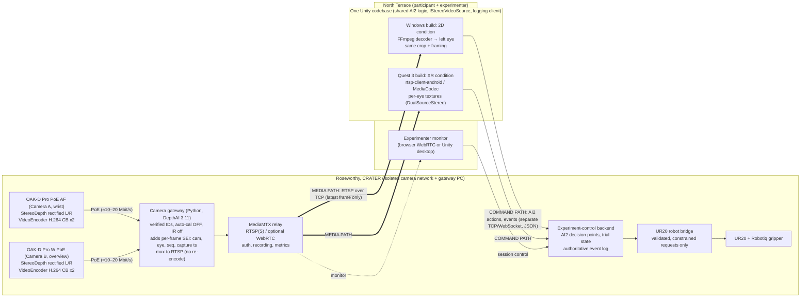

# Task 04A: open-source software and architecture audit for stereo video streaming

**Date:** 5 November 2026. **Scope:** research and planning only. Nothing was installed, cloned or executed apart from read-only queries. Repository metadata came from the GitHub API, and package metadata from the Unity package registry. Code and docs were read as raw files. The installed DepthAI 3.11.0 was inspected offline. No camera was accessed.

**Evidence labels:**
- **[V]** verified from source, release data or the installed package
- **[R]** reported by others (issues, forums), not reproduced
- **[I]** inference
- **[U]** unverified, needs a test

---

## 1. Summary

1. **Do not build on Unity WebRTC or Unity Render Streaming.**
   - `com.unity.webrtc` 3.0.0 (released 26 Sep 2025) supports **Unity 6000.3**, our target. But the README has said "com.unity.webrtc is deprecated" since **18 Aug 2026**, with no code commits since [V]. Unity 6000.4 reportedly marks it deprecated, and it fails there with a `NullReferenceException` [R].
   - H.264 is **hardware-only**: Windows needs an NVIDIA GPU (NVCODEC), Android uses MediaCodec. Open issues report **high H.264 frame drops on Android VR headsets**, a GPU→CPU→GPU copy, encoder failures on Quest 3, and only *Constrained Baseline* H.264 offered on Quest and Android [R].
   - Render Streaming depends on it and has only ever shipped experimental 3.1.0 releases, the last in Dec 2024 [V].
2. **The camera side is ready for H.264 encoded on the OAK.** DepthAI 3.11.0 `VideoEncoder` provides `H264_BASELINE`, CBR/VBR, keyframe frequency and `setNumBFrames`. `EncodedFrame` carries the sequence number, capture timestamps and frame type [V]. The encoder takes NV12 or GRAY8 input, has a combined budget of 248 Mpixel/s, and needs **width to be a multiple of 32** [V]. Encoding rectified 1280 × 800 mono eyes on the camera would cut the PoE link load from about 328 Mbit/s per camera (raw, Stage D) to roughly 10–20 Mbit/s [I]. That removes the Stage D bandwidth limit on streaming from both cameras at once.
3. **MediaMTX** (MIT, v1.21.3 released 25 Oct 2026, active) is a single dependency-free executable. It accepts and serves RTSP, SRT, WebRTC and more, converts between protocols, and has authentication, recording and metrics [V]. It is a good relay at CRATER: one ingest, many readers (participant client, experimenter monitor, recorder).
4. **Recommended primary stack:**

   **OAK on-device H.264 (Constrained Baseline, no B-frames)** → **CRATER gateway** (Python, DepthAI 3.11, adds per-frame metadata) → **MediaMTX** → **RTSP over TCP** → **one Unity codebase**.

   Behind one shared `IStereoVideoSource` interface there are two receiver back-ends:
   - **Windows:** FFmpeg/libavcodec
   - **Quest 3:** `rtsp-client-android` with low-latency MediaCodec (Apache-2.0, v6.1.3 released 29 Oct 2026, active [V])

   **Fallback:** per-frame JPEG over TCP or WebSocket (an extended version of the Side Quest framing), decoded natively on both platforms.
5. **Gate the move to Quest 3** on a desktop decoder that passes explicit criteria (§7). Begin with an **offline proof of concept** that replays saved Stage E stereo pairs, without cameras or Unity (§6).

---

## 2. Requirements used for the comparison

- Stereo from two OAK-D Pro PoE cameras (RVC2). Validated configuration: native 1280 × 800 mono, DepthAI 3.11.0, auto-calibration OFF, IR off, rectification on the device (camera checkpoint §11–12).
- Two conditions sharing one image path: **2D** (left eye, Windows) and **XR** (both eyes, Quest 3). Camera A crop x 39–1276 / y 6–775 applied to both eyes and to 2D. Camera B uncropped.
- From CRATER (Roseworthy) to North Terrace, over a university network or VPN that is not yet characterised.
- Per-frame identity and capture time end to end; logging of frame age and freezes; display of the latest frame (drop stale frames); automatic reconnection. Stage D showed 0.1–0.7 s delivery stalls on the local link alone (checkpoint §9.7).
- University laptop limits: per-user installs only, Wi-Fi/Ethernet Group Policy, firewall prompts. The Unity 6000.3.4f1 installation is currently blocked.
- Reuse of Side Quest assets where sensible: `DualSourceStereo.shadergraph` (two textures by Eye Index), V1 `FinalStereoGraph` (side-by-side), `TogglableReceiver` patterns (Task 01 audit §6).

---

## 3. Comparison matrix

| Component | Status and licence [V] | Fit to our requirements | Key evidence | Main risks | Recommended reuse |
|---|---|---|---|---|---|
| **Luxonis oak-examples** ([repo](https://github.com/luxonis/oak-examples)) | Apache-2.0; active (pushed 4 Nov 2026); examples pinned to `depthai==3.11.0` | Good **reference** for v3 encoding and RTSP | `on-device-encoding`: `Camera.requestOutput(NV12)` → `VideoEncoder.setDefaultProfilePreset(fps, H264_MAIN/H265_MAIN/MJPEG)`. `rtsp-streaming`: device H.265 → GStreamer `appsrc ! h265parse ! rtph265pay` RTSP server. `webrtc-streaming`: aiortc **re-encodes raw RGB frames on the host** (`VideoFrame.from_ndarray(..., "rgb24")`) | Examples use the colour CAM_A only; the RTSP example needs GStreamer (install notes for Ubuntu/macOS only); the WebRTC example wastes the device encoder and needs npm | **Pattern reuse** (encoder setup, bitstream handling); not deployed as-is |
| **DepthAI 3.11.0 VideoEncoder** (installed) | MIT ([depthai-core](https://github.com/luxonis/depthai-core)); 3.12.0 released 4 Nov 2026 with no RVC2 encoder changes | **Core of the media path** | Profiles `H264_BASELINE/MAIN/HIGH`, `H265_MAIN`, `MJPEG`; `CBR/VBR`; `setKeyframeFrequency`, `setNumBFrames`. `EncodedFrame.getSequenceNum/getTimestamp/getTimestampDevice/getFrameType` (I/P/B). [Docs](https://docs.luxonis.com/software-v3/depthai/depthai-components/nodes/video_encoder/): NV12 or GRAY8 input, 248 Mpixel/s, width multiple of 32 | Encoding **rectified** GRAY8 from `StereoDepth` is untested [U]; the encoder's added latency and keyframe behaviour are unmeasured [U] | **Use.** Keep DepthAI 3.11.0 (validated); evaluate 3.12 separately |
| **MediaMTX** ([repo](https://github.com/bluenviron/mediamtx)) | MIT; v1.21.3 (25 Oct 2026); about 20.6k stars; active | **Relay/server** at CRATER: RTSP(S) for the clients, WebRTC for a browser experimenter monitor, recording | README: publish and read over SRT, WebRTC, RTSP, RTMP, HLS and more, with automatic protocol conversion; authentication; recording; metrics; control API; "single executable", no dependencies | A university firewall may block listening ports [U]; Windows Defender may prompt for inbound access (admin) [U]. Best run on the CRATER gateway PC | **Use** as the relay |
| **GStreamer** ([site](https://gstreamer.freedesktop.org/)) | LGPL; 1.28.8; Windows per-user install supported since 1.28; Android arm64 binaries | Possible server or receiver pipeline | [Download page](https://gstreamer.freedesktop.org/download/): `.exe` installers with `/CURRENTUSER`, a `gstreamer-bundle` pip wheel, an Android universal tarball | Unity integration needs a custom native plugin per platform (appsink → texture); large binaries; plugin licence mix | **Not needed** for the primary stack (PyAV and MediaMTX cover the server side); keep as an alternative |
| **Unity WebRTC** ([repo](https://github.com/Unity-Technologies/com.unity.webrtc)) | Unity Companion licence; 3.0.0 (26 Sep 2025) for **Unity 6000.3**; **deprecated** (README note 18 Aug 2026); no code commits since | Would give one API on both platforms, but… | [Requirements](https://github.com/Unity-Technologies/com.unity.webrtc/blob/main/Documentation~/requirements.md): Unity 6000.3; Android ARM64 with IL2CPP. [Codecs](https://github.com/Unity-Technologies/com.unity.webrtc/blob/main/Documentation~/videostreaming.md): H.264 hardware only (Windows NVCODEC, needs NVIDIA driver ≥ 456.71; Android MediaCodec); software is VP8/VP9/AV1. Issues [#1112](https://github.com/Unity-Technologies/com.unity.webrtc/issues/1112) (Android H.264 frame drops, CPU round trip, Quest 3 encoder failures), [#980](https://github.com/Unity-Technologies/com.unity.webrtc/issues/980) (Constrained Baseline only on Quest/Android), [#838](https://github.com/Unity-Technologies/com.unity.webrtc/issues/838) (Quest stutter with Vulkan). [Forum](https://discussions.unity.com/t/is-com-unity-webrtc-still-supported/1718939): broken on 6000.4, no staff response | **Deprecated, frozen at 6000.3.** Quest H.264 decode weakness. The participant PC needs NVIDIA (this dev laptop has an RTX 4080 Laptop GPU [V]). No access to per-frame metadata. WebRTC needs UDP or ICE-TCP through the university network | **Do not adopt.** Throwaway desktop prototype at most |
| **Unity Render Streaming** ([repo](https://github.com/Unity-Technologies/UnityRenderStreaming)) | Unity Companion licence; only experimental 3.1.0-exp.9 (17 Dec 2024); README badges go up to Unity 2022 | Designed for Unity → browser, the opposite direction to ours | Depends on `com.unity.webrtc` | Inherits the deprecation; experimental; wrong direction | **Do not adopt** |
| **Luxonis OAK for Unity** ([depthai-unity](https://github.com/luxonis/depthai-unity)) | MIT; last push 27 Dec 2024; only tag `v0.1.0-beta`; README tested on Unity 2020.3/2021.2 | **Not applicable**: the camera connects directly to the Unity host | — | Pre-v3, stale, wrong topology (cameras are remote) | **No reuse** |
| **rtsp-client-android** ([repo](https://github.com/alexeyvasilyev/rtsp-client-android)) | Apache-2.0; 6.1.3 (29 Oct 2026); active | **Quest receiver back-end** | README: RTSP/RTSPS over TCP or UDP; H.264/H.265/AV1; **Low-Latency MediaCodec**; **no buffering** (unlike ExoPlayer); hardware or software decoder choice; min API 24 | Needs a Unity Android plugin (decode to Surface → external OES texture → Unity); behaviour on Quest 3, OpenGL ES against Vulkan, and SEI/metadata access are **unverified** [U] | **Primary candidate** (Quest) |
| **AndroidX Media3 / ExoPlayer** ([repo](https://github.com/androidx/media)) | Apache-2.0; 1.11.1 (11 Sep 2026); Google-maintained | Alternative Quest RTSP player | RTSP module; buffering by design (tunable) [I] | Buffering adds latency; same plugin work | **Secondary** if rtsp-client-android fails |
| **LiveKit Unity SDK** ([repo](https://github.com/livekit/client-sdk-unity)) | Apache-2.0; v2.1.1 (27 Oct 2026); active | Maintained WebRTC route for Unity | README: Windows, iOS, Android; tested on Unity 6000.3.10; libwebrtc through Rust FFI | Needs a LiveKit server plus an ingest service (which may transcode) [U]; WebRTC UDP through the university network; Quest decode path unverified [U] | **Watch-list alternative** if WebRTC is required (e.g. for a WAN without TCP) |
| **FFmpeg / libavcodec** (via PyAV on the gateway; a native or FFmpeg.AutoGen-style binding in Unity for Windows) | LGPL builds; PyAV wheels bundle FFmpeg (pip install, no admin) [I] | **Gateway muxing** (H.264 packets → RTSP to MediaMTX, no re-encode) and the **Windows receiver** | Widely used; low-delay flags (`-fflags nobuffer`, `-flags low_delay`) [I] | Unity binding choice and LGPL compliance to settle; D3D11 hardware decode optional (CPU decode of 1280 × 800 is cheap) [I] | **Primary** (gateway mux; Windows receiver) |
| **Side Quest assets** (Task 01 audit) | Read-only reference | Shaders and receiver patterns | `DualSourceStereo` takes two textures by Eye Index; V1 `FinalStereoGraph` splits side-by-side by UV; the `TogglableReceiver` threading pattern | Android external OES textures can't feed Shader Graph directly; a blit to a RenderTexture is needed [I] | **Reuse** shaders (copy, don't edit) and patterns |

---

## 4. Architecture options

| Option | Description | For | Against | Verdict |
|---|---|---|---|---|
| **A. One Unity codebase (Windows + Quest) with a shared `IStereoVideoSource` and platform back-ends** | Same experimental logic, AI2 UI, logging and frame handling; per-platform decoder plugins | One code path for both conditions, so image handling is matched and stereopsis is the only intended difference; reuses Side Quest assets | Two native decoder integrations; blocked until Unity is installed | **Recommended** |
| B. Browser 2D viewer (MediaMTX WebRTC/WHEP) + Unity XR | 2D in a browser; XR in Unity | Quickest 2D route; uses the browser's hardware decoder | **Different decode and timing paths per condition (a confound)**; AI2 UI and logging duplicated in web and Unity; WebRTC through the network | **Not for participants**; good for an **experimenter monitor** |
| B′. Web for both conditions (2D page + WebXR in Quest Browser) | Single web codebase, no Unity | Avoids the Unity installation block | Side Quest assets not reusable; WebXR per-eye stereo video and latency on Quest Browser not investigated [U] | **Contingency** only if Unity stays blocked |
| C. Separate media decoder process feeding Unity | An external process (GStreamer/FFmpeg) decodes and shares textures (e.g. shared memory or Spout) | Isolates codec problems from Unity on Windows | Not practical on Quest; Windows-only; inter-process synchronisation | **Desktop fallback** only |

### Architecture diagram (Option A, primary stack)

> **Superseded in part (5 Nov):** the [COROL integration addendum](Phase2_Task04A_Addendum_COROL_Integration_Audit.md) §11 replaces this diagram's CRATER side with the actual COROL components (UR20/rail/NUC gripper, twin server) plus a new task orchestrator, and splits communications into video, experimental state and robot control.

The media and command paths are **separate**: video never carries control, and participants never send motion commands. The backend validates AI2 requests and forwards only permitted actions to the robot bridge. No placement-correctness information reaches participant clients (Task 01 audit §8.4).

---

## 5. Recommended stack and fallback

### Primary

| Layer | Choice | Reason |
|---|---|---|
| **Encoding** | On-device `VideoEncoder`, **H264_BASELINE** (Constrained Baseline), **0 B-frames**, CBR, keyframe every 0.5–1 s, one encoder per eye from `StereoDepth.rectifiedLeft/Right` (GRAY8 → NV12) | Validated rectification stays on the device; decoder compatibility is widest (Android MediaCodec, Unity/WebRTC constraints); about 20× lower PoE load than raw [I] |
| **Packing** | **Two full-resolution streams per camera** (left and right paths), paired at the receiver by sequence number | Keeps on-device encoding. Side-by-side (2560 × 800) would need host composition and host encoding, putting raw rectified frames back on the PoE link (about 328 Mbit/s per camera, Stage D) |
| **Per-frame metadata** | The gateway inserts an H.264 **SEI user-data-unregistered** NAL before each access unit: camera ID, eye, `EncodedFrame` sequence number, device and host capture timestamps, configuration hash (crop, rectification) | Lets receivers measure frame age, detect gaps, pair eyes and log freezes without a side channel [I]; access in each receiver must be verified [U] |
| **Transport** | Gateway muxes the H.264 packets (PyAV) → **MediaMTX** at CRATER → **RTSP over TCP** (RTSPS once certificates are sorted) | One TCP port; firewall/VPN-friendly; MediaMTX fans out to several readers. TCP has head-of-line stalls under loss (cf. Stage D), so frame age must be logged |
| **Receivers** | Windows: FFmpeg low-delay decode → Texture2D. Quest: rtsp-client-android low-latency MediaCodec → Surface → OES → blit to RenderTexture. Both: **latest-frame-wins**, L/R pairing window, reconnect with backoff, freeze and frame-age logging | Behind one `IStereoVideoSource` interface in a single Unity project |
| **Presentation** | Per-eye textures into a copy of `DualSourceStereo`; 2D shows the left eye through the same material; Camera A crop by **UV in the shader** | Crop width 1238 is not a multiple of 32, so the full 1280 is encoded and cropped at display. Identical framing in both conditions |

### Fallback

**JPEG per eye over a single TCP or WebSocket connection,** using a "protocol v2" framing of `{magic, version, camera, eye, seq, capture ts, flags, length}` plus the JPEG (Task 02 audit §7).
- **Encoding:** MJPEG on the device (the docs report 2 × 800p at 55 fps).
- **Decoding:** a native libjpeg-turbo on both platforms.
- **For:** simplest; no keyframes, so recovery after a stall is immediate; metadata is trivial; and it is close to the Side Quest receiver.
- **Against:** about 30–40 Mbit/s per camera at 20 fps [I], so it depends on the university WAN.

### Not recommended

- Unity WebRTC or Render Streaming as the foundation.
- A browser for the participant 2D condition, because of the cross-condition confound.
- depthai-unity.

---

## 6. Offline proof-of-concept plan (saved stereo pairs, no cameras, no Unity)

**Purpose:** de-risk encoding, metadata, transport, pairing, stale-frame dropping and freeze logging before Unity is available.

1. **Source.** Replay the saved **rectified** pairs from the Stage E runs (E1/E2 groups; E6–E9 once captured) at 20 fps. Use synthetic sequence numbers and capture timestamps, and optionally a burned-in frame counter for a glass-to-glass test. *Data note:* the E1–E5 scenes contain an identifiable person; prefer E6–E9 frames, which should have no people, or synthetic patterns.
2. **Encoder stand-in.** libx264 Constrained Baseline, zero-latency tune, no B-frames, through PyAV, mirroring the device settings. (The OAK encoder itself is tested later on hardware.)
3. **Gateway prototype (Python).** Inserts SEI metadata and publishes two paths per camera (`camA/left`, `camA/right`) to a local MediaMTX.
4. **Reference receiver (Python, PyAV, Windows).**
   - Subscribes to both paths over RTSP/TCP, decodes, parses SEI and pairs by sequence number.
   - Keeps the latest frame only.
   - Logs per frame: arrival, decode, displayed sequence number and frame age.
   - Simulates display at 60 Hz.
5. **Fault injection at the sender:** pauses of 300 ms and 700 ms (as in Stage D), dropped frames, a server restart, and a receiver joining late (waits for a keyframe).
6. **Outputs:** per-frame CSV and a JSON summary in the same style as the Stage C/D tools.

**Dependencies (approval needed, nothing installed yet):**
- PyAV in the project virtual environment: `pip install av`, no admin.
- The MediaMTX Windows zip: a single exe, no installer. It may trigger a firewall prompt if bound beyond localhost; bind to `127.0.0.1` for the proof of concept.

**Unity is not required** for this stage.

---

## 7. Gates for moving from desktop decoding to Quest 3 stereo

**G1. Offline proof of concept (Python reference receiver, localhost).** All of these must pass:
- **Pairing:** 100% of delivered pairs have equal L/R sequence numbers; no mismatched pair is ever displayed.
- **Duration:** 10 minutes at 20 fps per camera, with no decoder errors.
- **Frame age** (synthetic capture → decode): median ≤ 60 ms, p95 ≤ 100 ms on localhost.
- **Stale frames:** after an injected 700 ms stall, the displayed frame age returns to baseline within ≤ 2 frames, and no backlog is played out in a burst.
- **Logging:** every injected stall and drop is logged with start, end and duration. Sequence gaps are counted exactly.
- **Reconnection:** after a server restart, the stream resumes within ≤ 3 s of the server returning.
- **Metadata:** SEI metadata survives the relay intact (checksum).

**G2. Unity Windows build (2D path), when Unity is available.** G1 metrics are repeated in Unity, plus:
- the decoder runs off the main thread, and Unity frame-time p99 is ≤ 1.5 × the display period during decoding;
- the left-eye image matches the source within the compression tolerance (PSNR ≥ 40 dB on a test pattern);
- Camera A's UV crop exactly matches `img[6:776, 39:1277]`;
- 60 minutes without memory growth.

**G3. Quest 3 build (XR path).** Proceed only after G2 passes. Then:
- MediaCodec decodes both eyes (Constrained Baseline, 1280 × 800 at 20 fps) for 20 minutes, with **no dropped XR frames attributable to decoding** at the headset refresh rate;
- frame age p95 ≤ the G2 value + 30 ms;
- **eye mapping is correct** (a test pattern marked left and right, plus an occluder test);
- pairing is 100%, reconnection works, and thermal behaviour is stable;
- the graphics API is decided (OpenGL ES against Vulkan for external textures).

A failure at G3 that persists after one fix iteration triggers the **JPEG fallback** for the XR path *and* the 2D path together, so the two conditions stay matched.

**G4. Live and network (later; hardware and IT approval).** The same metrics with OAK on-device encoding at CRATER, first on the LAN, then across the Roseworthy–North Terrace path; plus a glass-to-glass latency test.

---

## 8. Unresolved decisions

1. **Encoding:**
   - H.264 Constrained Baseline (recommended) against H.265 (lower bitrate; Quest support likely, but not on WebRTC paths);
   - bitrate per eye, keyframe interval and quality targets (Stage F image quality);
   - whether encoding `StereoDepth` rectified GRAY8 on the device works and how much latency it adds [U].
2. **Stereo packing:** two full-resolution streams paired by sequence number (recommended), against side-by-side 2560 × 800 composed on the gateway (needs host encoding and the raw PoE bandwidth).
3. **Transport:**
   - RTSP over TCP (recommended for firewall traversal) against RTP/UDP or SRT (lower latency under loss, firewall-dependent) against WebRTC (needs UDP or ICE-TCP; TURN);
   - RTSPS/TLS and authentication;
   - which machine hosts MediaMTX and the gateway at CRATER.
4. **Network connectivity (needs IT):**
   - routing between CRATER and North Terrace (direct, VPN or GlobalProtect);
   - firewall openings (one TCP port for RTSP(S) plus the command-path port);
   - available bandwidth (H.264: about 10–20 Mbit/s per camera; JPEG fallback: about 30–40);
   - whether the Quest 3 may join the university network (802.1X/eduroam limits) or needs a local router;
   - **clock synchronisation** (NTP or PTP) between sites, so frame age is meaningful across sites. Otherwise use relative age plus a glass-to-glass calibration.
5. **Unity installation:** Unity 6000.3.4f1 with Windows and Android build support (SDK/NDK/JDK) is blocked; IT approval or a managed install is needed. Until then the proof of concept proceeds in Python (§6). If Unity stays blocked long-term, revisit Option B′.
6. **Receiver implementation details:** the Windows FFmpeg binding (native plugin against a managed wrapper; LGPL compliance); access to SEI or per-NAL callbacks in rtsp-client-android [U]; the external-texture path on Quest (OpenGL ES against Vulkan).
7. **Freeze handling for participants:** whether a stale-frame indicator is shown is a research-design decision (camera checkpoint §9.7). Logging is required either way.
8. **DepthAI version:** stay on the validated 3.11.0 for Task 04; evaluate 3.12.0 separately later (its release notes show no RVC2 encoder changes; never set `dangerousIrPowerOverride`).

---

## 9. Sources (accessed 5 Nov 2026)

- Unity WebRTC: [repository](https://github.com/Unity-Technologies/com.unity.webrtc), [requirements](https://github.com/Unity-Technologies/com.unity.webrtc/blob/main/Documentation~/requirements.md), [video codecs](https://github.com/Unity-Technologies/com.unity.webrtc/blob/main/Documentation~/videostreaming.md), issues [#1112](https://github.com/Unity-Technologies/com.unity.webrtc/issues/1112), [#980](https://github.com/Unity-Technologies/com.unity.webrtc/issues/980), [#838](https://github.com/Unity-Technologies/com.unity.webrtc/issues/838); [forum: "Is com_unity_webrtc still supported?"](https://discussions.unity.com/t/is-com-unity-webrtc-still-supported/1718939); Unity package registry (`packages.unity.com/com.unity.webrtc`: 3.0.0 released 2025-09-26, Unity 6000.0+)
- [Unity Render Streaming](https://github.com/Unity-Technologies/UnityRenderStreaming) (registry: latest 3.1.0-exp.9, 2024-12-17)
- [Luxonis oak-examples](https://github.com/luxonis/oak-examples) (`streaming/on-device-encoding`, `rtsp-streaming`, `webrtc-streaming`); [DepthAI VideoEncoder docs](https://docs.luxonis.com/software-v3/depthai/depthai-components/nodes/video_encoder/); [depthai-core releases](https://github.com/luxonis/depthai-core/releases) (v3.12.0, 2026-11-04)
- [Luxonis depthai-unity](https://github.com/luxonis/depthai-unity)
- [MediaMTX](https://github.com/bluenviron/mediamtx) (v1.21.3, 2026-10-25)
- [GStreamer download](https://gstreamer.freedesktop.org/download/) (1.28.8)
- [rtsp-client-android](https://github.com/alexeyvasilyev/rtsp-client-android) (6.1.3, 2026-10-29); [AndroidX Media3](https://github.com/androidx/media) (1.11.1, 2026-09-11); [LiveKit Unity SDK](https://github.com/livekit/client-sdk-unity) (v2.1.1, 2026-10-27)
- Project evidence: Task 01 audit (`SideQuest_Phase2_Technical_Audit.md`), Task 02 audit (`Phase2_Task02_Camera_Sender_Audit.md`), camera checkpoint §9 (stalls), §11–12 (rectification and crop)
