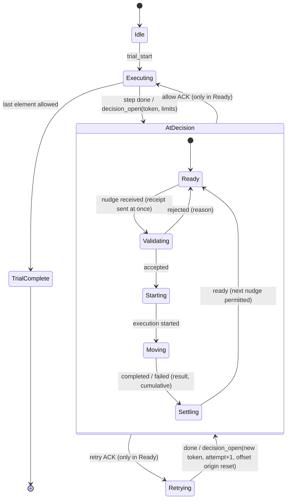

# Task 07: AI2 supervisory interface, design proposal and implementation architecture

**Status: revision 2 APPROVED by the researcher (6 Nov 2026)** as the preferred Task 07 interface concept, with nine further decisions.
- **The further decisions:** held-element correction (provisional); show only the accepted cumulative **commanded** offset; Retry resets only once the new attempt has started; selectable backend-defined step sizes; provisional backend-enforced limits; independent nudges; separately logged lifecycle times; Inspect throughout nudging; AIML questions drafted, not sent.
- **Where they are recorded:** §1 of [Task 07 S1 implementation and results](Phase2_Task07_S1_Implementation_Results.md).
- **S1** (pure C# state machine, simulated backend, messages and tests) **is complete**. S2 onwards awaits approval.
- **Update (11 Nov 2026):**
  - **S2 complete** (7 Nov).
  - **S3 implemented and verified,** awaiting review: the Windows participant interface. Its departures from the mock-up and the open decisions S3-1 to S3-7 are in [S3 results](Phase2_Task07_S3_Implementation_Results.md) §3 and §9.
  - **S3 committed** as `e418f62` (12 Nov). **S3.1 implemented and verified, awaiting review (12 Nov):** the released-element workflow (recovery, facilitator, rotation, Place and release) replaces the held-element assumption; see the [S3.1 CONOPS](Phase2_Task07_S3_1_Revised_CONOPS.md).
  - **S4 not started.**
- Revision 2 (6 Nov 2026) incorporated researcher decisions R1 and R2 (§0.1).

**Companion mock-up** (non-invasive, outside Unity): [`design/task07_ai2_mockup/index.html`](../../design/task07_ai2_mockup/index.html).
- **What it is:** a clickable browser prototype of the Windows layout, with a simulated backend (including simulated nudge execution visible in the placeholder video) and a live event-log drawer.
- **How to use it:** open it in a browser; nothing is installed or launched. Jump to a state with `#demo=inspect`, `nudge`, `moving`, `inspectnudge`, `confirm`, `rejected` or `freeze`; `#xr` opens the Quest 3 sketch. See its README.

**Supersedes:** the client state machine (§3) and message schema v0 (§2) of [`Phase2_Task07_AI2_Supervisory_Interface_Plan.md`](Phase2_Task07_AI2_Supervisory_Interface_Plan.md). That plan's architecture layers, boundaries and verification ideas (M1.8 frame-time check, log checker) are kept.

**Labels:** **[V]** verified in source or measurement; **[A]** assumption; **[D]** decision needed from the researcher; **[R]** researcher decision.

> **Simulation only.** Every acknowledgement, validation, execution status and timing in this document and the mock-up comes from an in-process **simulated** backend. **An acknowledgement of receipt says nothing about when or whether physical motion occurs.** Real execution behaviour (latency, settling, achieved displacement, failure modes and the physical meaning of a nudge) must be commissioned and validated separately with CRATER/AIML before any robot integration. No COROL or robot code is contacted, imported or run.

---

## 0. Decisions and conflicts

### 0.1 Researcher decisions (6 Nov 2026)

| ID | Decision | Effect on this design |
|---|---|---|
| **R1** | Participants may initiate **Allow or Intervene directly from Inspect**. They are not forced back to the primary camera or default zoom first. The active camera, zoom level, inspection state and displayed video frame are logged at the moment of decision | **Inspect becomes an orthogonal view layer** that can stay active while the participant decides or nudges (§3.3). The view is restored to the primary camera at 1× only when the decision point closes (task continues), never *before* a decision. Replaces revision 1's D1 recommendation |
| **R2** | **Bounded corrections are incremental micro-teleoperation:** each nudge is an individual request, processed immediately, never batched. Lifecycle: receipt acknowledged → backend validates → executes that single correction → reports the execution result → permits the next nudge. Cumulative displacement tracking; configurable step sizes; backend-enforced limits; individual command IDs, timestamps and results. **Retry stays separate.** Simulated only | Replaces revision 1's "compose an offset, then send once" composer. Adds a per-nudge lifecycle (§3.4), new messages (§3.5) and the **Adjust panel** (§1). Retry remains a terminal decision with a two-step confirm |

### 0.2 Conflicts with existing documents (flagged, not silently resolved)

| # | Existing statement | Conflict | How this proposal treats it |
|---|---|---|---|
| K1 | Task 07 plan §4 "Not in scope: … **Camera B and source switching**" | Inspect requires switching between the wrist (A) and overview (B) cameras | **Brought into scope.** Camera B has never been streamed into Unity [V]. Its crop is undefined (uncropped 1280 × 800 approved), and it has a residual vertical offset and roll (camera checkpoint, outstanding issues). See S2 and D10 |
| K2 | Task 07 plan §3 "**One intent per decision**" | Repeated Inspect; many nudges per decision point | One **terminal** request (Allow or Retry) per decision token. Any number of Inspect episodes and nudges (within limits) before it |
| K3 | COROL addendum §7–8: Inspect uses **pre-validated inspection poses** (the arm moves) | Brief: Inspect = additional observation; **the task stays paused** | Inspect is **hold-only**. The inspection-pose idea is treated as superseded |
| K4 | Side Quest audit §8.1 (zoom/status as general features); B9 (free camera switching) | Camera switching and zoom **only during Inspect** | Superseded, as the brief states |
| K5 | Task 07 plan §5.2 ("timeout and default action (if any)") | No automatic participant decision timeout unless approved | **No decision timeout, no countdown, no visible clock.** Only *system* timeouts remain (receipt, execution), which signal faults |
| K6 | COROL addendum §8.4: release to robot "automatic within bounds, or **experimenter confirmation**" | Experimenter confirmation of **each nudge** would make micro-teleoperation unresponsive and add human-variable latency | The simulation models **automatic within bounds**. If CRATER/AIML require a human release per nudge, R2 needs revisiting [D, commissioning] |
| K7 | Side Quest audit Q4 (zoom in stereo: match by FOV or magnification?) | Zoom is now an experimental capability in both conditions | Unresolved; a genuine confound (§6, D7) |
| K8 | COROL addendum §8.2–8.3 and Task 07 plan §2: the correction is **one offset** (dx, dy) from a "bounded discrete set", applied to a stored above- or descent-pose, then re-validated | R2: **a sequence of individual nudges**, each executed and reported before the next | The bounds (per axis, cumulative) carry over and are enforced **per nudge against the backend's measured cumulative offset**. What a nudge physically moves is **unknown** (D14) |
| K9 | COROL addendum §8.5: "motion only at step boundaries; no participant action may trigger or alter a move in flight" | Nudges trigger motion during a decision point | Compatible if a decision point counts as a step boundary: a nudge is accepted only while the task is held at a decision point **and** the previous nudge has completed. Nothing alters a move in flight. Needs AIML confirmation |

There is no §13.20 in the camera checkpoint (latest: §13.19).

---

## 1. Design concept: "Site Window", with two wings

The participant sits at the window of a site office overlooking a remote work face. Revision 2 adds two wings beside the window, like a triptych:

| Part | Where | Role |
|---|---|---|
| **The Window** | Centre | The video plate. Large, calm, never covered by controls |
| **View wing** | Left of the Window | **Inspect** tools: camera, zoom, location map, end inspection. It unfolds only during Inspect |
| **Adjust wing** | Right of the Window | **Intervene** tools: **nudge pad** with live execution status and cumulative offset; **Retry** kept apart below a rule. It unfolds only when Intervene is opened |
| **The Desk** | Below everything | The three AI2 keys (Allow · Inspect · Intervene), always in the same place; the step card; a short record of this decision point's requests |

**Why wings instead of revision 1's single changing desk:** R1 and R2 mean Inspect and Intervene can be active **at the same time**. For example, a participant zooms in on the overview camera, nudges, watches the result at 3× and then Allows from there. Two independent wings let both sets of tools coexist without one replacing the other.
- **Shared edges:** each wing shares its edge with the image, so the controls that change *what you see* (left) and *what the robot does* (right) sit next to the image they affect.
- **Stable Desk:** it keeps the three decision keys in a fixed position at all times.

The visual language is unchanged from revision 1: architectural drawing and survey instruments (hairline rules, registration marks, a title-block step card, tabular numerals, paper-coloured type on warm graphite). No SCADA tiles, no sci-fi HUD.

### 1.1 Main design choices and reasons

| Choice | Reason |
|---|---|
| **No controls over the image.** All labels sit on the caption line above the plate | Plan §5.5 (do not cover the task area), and the logged "displayed frame" equals what was visible |
| **Camera A at exactly 1:1 at 1×** (1238 × 770 source pixels); Camera B fitted (scale 0.9625) | No resampling at the default view; the pixel-exact render check stays meaningful |
| **Achromatic interface; exactly two non-evaluative hues.** *Lens blue* = inspecting. *Signal amber* = a system condition (video interrupted, request rejected, no confirmation, movement not completed) | The video is greyscale, so any hue is salient. **No green or red** in participant mode: they would read as correct/incorrect |
| **Three equal decision keys in a fixed order**, always in the same place on the Desk. No default focus | No option is visually recommended. Spatial stability. The same order in both conditions |
| **Inspect and Intervene are toggles that open their wings.** The key shows that its mode is active; clicking it again (or the wing's own close button) closes the mode | Both modes can be open together (R1, R2). One consistent rule: *a key opens its wing* |
| **Allow and Retry need a second click to confirm**, in a confirm row on the Desk that names the current view (e.g. *you are viewing the overview camera at 2×*). Inspect, Intervene and nudges are single clicks | Allow and Retry are terminal and cannot be undone. A nudge is small, bounded and reversible by an opposite nudge, and micro-teleoperation must stay responsive. The confirm row shows the view so that R1 decisions are deliberate |
| **One nudge at a time, with a visible lifecycle:** *Sent → Received → Accepted → Moving → Done*. The pad locks from the click until the backend says the next nudge is permitted | Implements R2 exactly. Showing **Received** and **Moving** as separate stages means participants are never told that receipt means motion |
| **Cumulative offset is shown as reported by the backend**, with a small plan diagram showing the origin, the permitted range, the trail of completed nudges and the current position | The backend is the authority on where the element is. The client never sums its own requests into a displayed position |
| **Arrows grey out when the next step would exceed a limit**, but the backend still validates every nudge | The client only gives guidance. Enforcement is the backend's (rejections are shown and logged) |
| **Retry is visually and spatially separate** from nudging (below a rule, with its own description and a two-step confirm) | R2: keep Retry separate. Retry ends the decision point; nudging does not |
| **Video state and task state are shown in different places** | A frozen image never reads as "robot stopped" or "nudge done". Execution status comes **only** from backend messages |
| **No timers, no counters of inspections, no scores** | No time pressure; nothing that could act as a cue |
| **Mouse only; keyboard ignored in participant mode; no sound or haptics** | Equivalence with XR (ray + trigger) |
| **Typography:** IBM Plex Sans and Mono (OFL), minimum 18 px body text at 1080p | Legible technical type with tabular figures. The font download needs approval (D11) |

### 1.2 Participant-visible information (and what is withheld)

| Where | Shows | Source |
|---|---|---|
| **Top strip** | Trial; task status from a closed vocabulary: *Robot placing element*, *Holding for your decision*, *Held for inspection*, *Nudge received, waiting to start*, *Moving: 2 mm along rail*, *Retrying placement*, *Paused by the experimenter* | Backend `task_status` / nudge lifecycle |
| **Caption line** | The camera on screen and its role; in Inspect, the zoom level; on the right, the video state (*Live*, or amber *Video interrupted · n s*) | Client view state; receiver freshness |
| **Step card** (Desk, left) | The **intent** of the step: element, operation, target position, attempt | Backend `decision_open` |
| **Record** (Desk, right) | The last few requests at this decision point, in plain language (*Nudge 3 · 2 mm along rail · done*; *Inspection started*) | Backend acknowledgements and results |
| **View wing** | Camera selector, zoom, location map, camera description | Client view state; static configuration |
| **Adjust wing** | Step-size selector (from the backend's permitted set); nudge pad; current nudge lifecycle; **offset from the original placement** (backend-reported); nudges remaining; Retry | Backend `decision_open` limits, `nudge_*` messages |

**Never shown in participant mode:** verification results, hidden fault labels, recommendations, scores, frame IDs, sequence numbers, command IDs, decoder statistics and latency figures, the right-eye inset, and the F1/F2 developer overlay (enabled only by the experimenter's command-line flag).

**Leak rule:** status phrases, their timing and **nudge execution timing** must be identical whatever the hidden condition. This is enforced by the S1 leak test (§3.6).

---

## 2. Participant journey through one decision point

The example is Element 3 of 8, with the primary camera set to *Wrist* by the protocol. All timings are **simulator defaults** and configurable; they are not predictions of the real cell.

1. **Monitoring.** The status reads *Robot placing element*. The wrist camera is shown at 1×. The Desk keys are dormant, and both wings are folded (a hairline outline with a quiet label).
2. **Decision opens** (`decision_open`, token `DP-T2-E03-A1-…`). The status reads *Holding for your decision*. The three keys fade up together: no sound, no flash, no clock.
3. **Inspect.** One click on **Inspect**. The Record shows *Inspection requested*. On ACK:
   - the Window frame turns lens blue, with registration marks;
   - the **View wing** unfolds: **Wrist | Overview**, **1× · 2× · 3×**, **Reset view**, a location map and **End inspection**;
   - the Inspect key shows *Active*.
4. **Looking.** Click on the image to zoom in at that point; drag to pan. Switch to Overview (instant: both cameras stream continuously). Every view change is logged with its source-pixel rectangle.
5. **Intervene while still inspecting (R1).** One click on **Intervene**. The **Adjust wing** unfolds while the View wing stays open, and the overview camera stays at 2×. Nothing is reset.
6. **First nudge (R2).** Step size *2 mm* is selected (from the backend's permitted set {1, 2, 5} mm). Clicking **▶ along rail**:
   - **Sent:** the whole pad locks at once, and the lifecycle row highlights *Sent*.
   - **Received** (simulated about 60 ms): *Received*, and the status reads *Nudge received, waiting to start*. **This is receipt only.**
   - **Accepted** (validation, about 120 ms): *Accepted*. If the nudge would exceed a limit, it is *Rejected* (amber) with a reason, and the pad unlocks.
   - **Moving** (simulated start delay 250 ms, motion 700 ms): *Moving*; the status reads *Moving: 2 mm along rail*. In the mock-up the block visibly shifts in the video.
   - **Done** (with the result): the offset readout updates from the backend's report to *Along rail +2 mm · Across 0 mm*, and the plan diagram adds a trail point. A failed movement shows amber *Movement not completed* and the reported offset.
   - **Ready** (after a configurable settle, 300 ms): the pad unlocks for the next nudge.
7. **Observe, then nudge again.** The participant zooms to 3× on the wrist camera, sees the element still slightly off, and nudges ▼ *across* by 1 mm. Each nudge is a separate request with its own command ID, timestamps and result. Nothing is queued or batched; extra clicks while the pad is locked do nothing (they are logged as `input_ignored`).
8. **Allow from Inspect at 3× (R1).** The participant clicks **Allow**. The Desk confirm row reads *Confirm Allow: the task will continue to the next element* and *You are viewing: wrist camera, 3×*. On confirmation, the log records the commitment with the inspection state, camera, zoom, viewport rectangle, the displayed frame of both cameras and the current cumulative offset.
9. **Acknowledged.** The decision point closes. Inspect ends automatically, the view returns to the primary camera at 1× (logged as `view_restore`, cause `decision_close`), both wings fold, and the status reads *Robot placing element* for Element 4.

**Alternative ending: Retry.** In the Adjust wing, below the rule, **Retry placement…** opens the Desk confirm row (*The robot will repeat the placement of this element from the start. Nudges made at this decision point will not be kept.*). On confirmation the decision point closes, and a new one opens for the same element (*Attempt 2*), with a fresh offset origin.

**Conditions that can arise at any time:**
- **Experimenter pause:** the Desk and the pad lock with *Paused by the experimenter*; the video continues. A nudge already in progress completes its lifecycle (the backend decides; the client only reports).
- **No receipt** within the receipt timeout (simulated 1 s), or **no completion** within the execution timeout (simulated 10 s): the lifecycle row turns amber with *No confirmation from the site. The experimenter has been alerted.* Inputs stay locked until the experimenter resolves it.
- **Video interruption:** an amber caption after 500 ms without a fresh pair. Nudging and deciding remain possible (D8); the video state is logged at every request.

---

## 3. States, transitions and architecture

### 3.1 Two machines, one source of truth

- **Backend trial machine** (authoritative; inside `SimulatedBackend`, later the real experiment backend): tokens, limits, validation, nudge execution, cumulative offset.
- **Client supervisory machine** (pure C#, shared by Windows and XR): a projection of backend messages plus the local **view state** (camera, zoom, centre).

### 3.2 Backend trial machine

**Notes:**
- **Inspect is a flag on `AtDecision`** (`inspecting`, set and cleared by `inspect_begin` / `inspect_end`, each ACKed). It does not block nudges or decisions.
- **Experimenter pause** overlays any state and resumes to it.
- **Allow, Retry and Inspect requests arrive only in `Ready`.** One that arrives during a nudge lifecycle is NACKed with `busy`; the UI prevents this anyway.

**Nudge validation, in order** (each failure is a `nudge_rejected` with a reason code, and is logged):
1. schema;
2. session;
3. current token;
4. state is `Ready` (one nudge at a time);
5. not paused;
6. `step_mm` ∈ the permitted set;
7. axis ∈ the permitted axes;
8. |measured cumulative + step| ≤ the per-axis limit;
9. nudges at this decision point < the cap;
10. not a duplicate `client_cmd_id`.

**Bounds are checked against the backend's measured cumulative offset**, not the client's view of it.

### 3.3 Client supervisory machine (two orthogonal regions)

**Region V (view):**

| State | View | Transitions |
|---|---|---|
| `Primary` | Forced to `{primary_camera(token), 1×, centre}` | `inspect_begin` ACK → `Inspecting` |
| `Inspecting(k)` | Free: camera, zoom, pan (local, immediate, logged and forwarded as `view` telemetry) | `inspect_end` ACK, or **decision close**, pause-then-close or link loss → `Primary` (restore logged with its cause) |

**Region W (workflow):**

| State | Desk / Adjust wing | Accepts | Exits |
|---|---|---|---|
| `Monitoring` | dormant keys, wings folded | — | `decision_open` → `Open` |
| `Open` | three live keys | Allow, Inspect (toggle), Intervene (toggle); nudge pad if the Adjust wing is open; Retry | Allow → `Armed(allow)`; Retry → `Armed(retry)`; nudge → `Nudging` |
| `Armed(allow\|retry)` | confirm row with the current view named, plus Cancel | Confirm, Cancel | Confirm → `Pending`; Cancel → `Open` |
| `Pending(request)` | request in the Record; keys locked | — | ACK → next; NACK → `Open` (amber); timeout → `Unconfirmed` |
| `Nudging(cmd)` | lifecycle row active; pad and AI2 keys locked; **View wing stays usable** | camera, zoom, pan only | `nudge_ready` → `Open`; a timeout → `Unconfirmed` |
| `Unconfirmed` | amber system message | — | experimenter resolves |
| `Paused` (overlay), `LinkLost` (overlay), `Ended` | as revision 1 | — | — |

**Rules:**
- The view is **never** reset before or because of a decision (R1). It is restored only when the decision point closes or Inspect ends.
- Camera and zoom remain available **while a nudge executes**, so the participant can watch the result. They remain unavailable outside Inspect.
- The Adjust wing may be closed at any time outside `Nudging`. Closing it does **not** undo nudges; the offset stays as executed.

### 3.4 The nudge lifecycle (one request, one execution)

| # | Message (backend → client) | Meaning | What the participant sees |
|---|---|---|---|
| 0 | (client sends `nudge`) | Request sent | Pad locks; *Sent* |
| 1 | `nudge_received` | **Receipt only.** It implies nothing about motion or its timing | *Received*; status *Nudge received, waiting to start* |
| 2 | `nudge_accepted` / `nudge_rejected{reason}` | Validation result | *Accepted* / amber *Rejected: would exceed the ±15 mm limit along rail* (pad unlocks) |
| 3 | `nudge_executing` | Execution has started (in the real system: when the orchestrator reports motion start) | *Moving*; status *Moving: 2 mm along rail* |
| 4 | `nudge_completed{result}` / `nudge_failed{reason, result}` | Execution result: commanded and **achieved** displacement, **cumulative offset after the move**, and the end time | *Done* plus the updated offset / amber *Movement not completed* plus the reported offset |
| 5 | `nudge_ready{remaining, cumulative}` | The backend permits another action | Pad unlocks |

**Timeouts** (system faults, not participant time limits):
- receipt (1 → 0);
- validation (2 → 1);
- execution (4 → 3);
- ready (5 → 4).

Each is configurable, and none triggers a silent retry.

### 3.5 Messages (schema v1.1, JSON lines, in-process now)

**Backend → client:**
- `hello`, `trial_start`, `task_status{status_code, element_index, detail?}`;
- `decision_open{token, element{id, operation, target_label}, attempt, primary_camera, options[allow, inspect, intervene], intervene{retry, nudge{axes[along_rail, across], step_sizes_mm[1,2,5], default_step_mm, max_abs_mm_per_axis, max_nudges}}}`;
- `ack` / `nack{client_cmd_id, token, request, reason}`: for inspect_begin, inspect_end, allow and retry;
- `nudge_received` / `nudge_accepted` / `nudge_rejected` / `nudge_executing` / `nudge_completed` / `nudge_failed` / `nudge_ready`: each carries `{client_cmd_id, token, nudge_seq, t_backend_mono_ns, t_backend_utc_ns}` plus its payload;
- `decision_close{token, reason}`, `paused`, `resumed`, `trial_end`.

**Client → backend:**
- `request{client_cmd_id, token, kind: inspect_begin | inspect_end | allow | retry, …context}`;
- `nudge{client_cmd_id, token, nudge_seq, axis, direction: +1|-1, step_mm, …context}`.

**`context`** on every request:
- `t_mono_ns` and `t_utc_ns`;
- `inspecting`;
- `view{camera, zoom, rect_src_px}`;
- `displayed{on_screen, A{seq, t_capture_utc_ns, age_ms}, B{…}}`;
- `video_state`;
- `cumulative_shown_mm` (what the participant was looking at).

**Telemetry (no ACK):** `view`, `video_state`.

**Information firewall:**
- Requests carry only values from closed sets (axis, direction, a step from the permitted list). There are no free coordinates, poses or speeds.
- Backend → client messages come from an **allow-listed** schema.
- **Leak test (S1):** each scenario is run with its hidden conditions permuted. The client-bound stream, with IDs and timestamps stripped, and the timing of every message must be identical, **including all nudge lifecycle timings and results**.

### 3.6 Code structure

| Assembly | Contents | Engine refs |
|---|---|---|
| `Phase2.Experiment.Core` (new) | Schema v1.1 and serialiser; `SupervisorMachine` (two regions); `NudgeLifecycle` tracker (per command: stage, timestamps, timeouts); `ViewState` (camera, discrete zoom, pan clamping in source pixels); `IExperimentBackend`; event records through the existing `EventLog` | none |
| `Phase2.Experiment.Sim` (new) | `SimulatedBackend`: trial machine, validation, limits; **`SimulatedNudgeExecutor`** (configurable receipt, validation, start, motion and settle delays; deterministic achieved displacement, optionally with configured error; injectable failure); scenario and limit files; a deterministic clock; fault injection | none |
| `Phase2.Experiment.Unity` (new) | `SupervisorPresenter`; `WindowView` (zoom via the existing `LumaUnlit` `_Crop` sub-rectangle, no shader change); `ViewWing`, `AdjustWing`, `DeskView` (uGUI + TextMeshPro); `ParticipantStrings`; `DevMode` | Unity |
| Video (existing) | `ReceiverCore`, `StereoPresenter`, FFmpeg backend, `LumaUnlit`. One receiver per camera, both continuous | unchanged |

**Unchanged from revision 1:**
- **uGUI + TMP** over UI Toolkit: the same prefabs work screen-space and world-space, and XR ray input is proven [V].
- **Both cameras streaming continuously.**
- **The opt-in `createDisplay` flag** on `StereoReceiverBehaviour`, gated on the M1 regression (D12).

**The simulated executor is deliberately abstract:** it moves a number, not a robot. Nothing in `.Sim` models robot kinematics, and its delays are placeholders to be replaced by commissioned values.

### 3.7 Logging (client event log, existing `EventLog` schema, QPC and UTC on every record)

**Every record carries:** session, trial, `ui_state` (both regions), token, `client_cmd_id` (if any), `inspecting`, `view{camera, zoom, rect_src_px}`, the **displayed frame** of the on-screen camera and the latest frame of the other camera, and `cumulative_mm` (as last reported).

**Event types:**
- decisions: `decision_open` / `decision_close`; `choice`, `arm_cancel`, `commit` (R1: with the full view context), `request_sent`, `ack`, `nack`, `ack_timeout`;
- Inspect: `inspect_begin` / `inspect_end` (episode, dwell, cause), `view_camera`, `view_zoom` (anchor), `view_pan`, `view_reset`, `view_restore` (cause);
- Intervene: `intervene_open` / `intervene_close`; `step_size_select`;
- **nudges:** `nudge_sent`, `nudge_received`, `nudge_accepted` / `nudge_rejected`, `nudge_executing`, `nudge_completed` / `nudge_failed` (commanded, achieved, cumulative), `nudge_ready`, `nudge_timeout`, `input_ignored` (a click while the pad was locked);
- `option_hover_begin` / `_end`, `video_state`, `paused` / `resumed`, `link`, `trial_end`.

**Derived measures** (log checker):
- decision latency, first-action latency;
- Inspect episodes, dwell per camera and zoom;
- **per nudge:** receipt latency, validation latency, start delay, execution duration, settle; **observation time** (ready → next nudge or decision); nudges per decision point; path length vs net offset; reversals;
- the view at each commitment.

**Integrity checks:**
- no camera or zoom other than the primary view at 1× outside Inspect;
- one terminal commit per token;
- **at most one nudge in flight at any time**;
- every nudge reaches exactly one terminal stage (rejected, completed, failed or timeout);
- the displayed cumulative offset always equals the last backend report;
- no nudge sent before the previous `nudge_ready`.

---

## 4. Translation to Quest 3 (later; not part of Task 07)

| Windows | Quest 3 |
|---|---|
| Plate, 1238 × 770 px | **World-locked stereo screen**, at a fixed distance (about 2 m), sized per D6 |
| **View wing / Adjust wing** beside the plate | **Two side panels hinged at the screen edges and angled about 25° towards the participant** (a triptych). The same prefabs in world-space canvases. Their targets are sized for ray precision at 2 m (nudge arrows at least 2.5° across) |
| Desk below | A **lectern panel** about 0.6 m ahead, about 30° below eye level: the same Desk prefab |
| Mouse point, click, drag | Controller **ray + trigger** (D9). **The thumbstick is not used for nudging:** it would turn discrete requests into continuous control |
| Lens-blue frame in Inspect | The same frame; no lighting change |

**Not permitted in XR:** head-locked UI, gaze-dwell, audio or haptic cues, lighting changes, and continuous (analogue) nudge input.

---

## 5. Staged implementation plan (each stage ends at a review gate; all offline)

| Stage | Deliverable | Verification | Touches existing code? |
|---|---|---|---|
| **S0** (this) | Proposal rev. 2 and mock-up | Review | No |
| **S1: core and simulated backend** | `Experiment.Core` + `.Sim`: schema v1.1, both machines, `NudgeLifecycle`, `SimulatedNudgeExecutor`, `ViewState`, scenarios and limits, fault injection | EditMode tests: • every transition; decision from Inspect at any zoom (R1); view restore only on close; • **nudge lifecycle:** order of stages; one in flight; locked-pad clicks ignored and logged; every rejection reason; limits against the *measured* cumulative; failures; each timeout; • pause during a nudge; Retry resets the origin; • allow-list and leak tests; deterministic replay produces a byte-identical log | No |
| **S2: two-camera supervisory video** | `createDisplay` flag (D12); `WindowView` for A or B with `_Crop` zoom; Camera B offline input (D10) | **Full M1 regression unchanged**; render check pixel-exact at 1×; zoom geometry test; switching never shows an unpaired or stale frame | Yes (one flag) |
| **S3: Windows participant UI** | New scene `AI2_Windows` (the M1 scene untouched); Window, two wings, Desk; strings; mouse only; dev mode by flag | PlayMode scripted trials through every state, including nudging while inspecting, rejection, failure and timeouts; **M1.8 frame-time check with the UI active**; participant-mode lint | No |
| **S4: session runner and log checker** | Player build; scripted 5-minute sessions; `check_ai2_log.py` | Checker PASS; corrupted logs are caught (two nudges in flight, a missing terminal stage, a view change outside Inspect) | No |
| **Gate** | Walk-through with the researcher; optional think-aloud pilot | Researcher decision | — |
| **Later, separate approvals** | **Commissioning with CRATER/AIML:** what a nudge moves; real latencies and settling; achieved-displacement measurement; limits; failure modes. Then the Quest translation | — | — |

---

## 6. Equivalence between the Windows and XR conditions

| # | Risk | Mitigation | Decision? |
|---|---|---|---|
| E1 | **Effective resolution vs angular size** (Quest 3 about 25 px/deg [A]; matching angular size downsamples 1238 px) | Zoom defined in source pixels; logs comparable | **D6** |
| E2 | **Stereo zoom comfort** (disparity scales with zoom); **now also during nudging**, when participants are likely to watch at 3× | A common zoom cap | **D7** |
| E3 | Camera B rectification quality affects only XR | Fix before XR, or record | with D10 |
| E4 | **Interaction cost, amplified by nudging.** Repeated small targets favour the mouse; ray jitter could cause mis-clicks on adjacent arrows | Equal angular target sizes; arrows spaced apart; `input_ignored` and hover logs allow analysis of mis-clicks | No (analysis note) |
| E5 | **Execution latency is the same for both conditions** (it is backend/robot time), but its *perceived* cost may differ with immersion | The same lifecycle stages, wording and timeouts | No |
| E6 | Text legibility | One string table | No |
| E7 | Surround | Dark full-screen Windows; minimal XR room | Partly (Side Quest Q11) |
| E8 | Random live video interruptions | The same thresholds; `video_state` on every request | D8 |
| E9 | Decode load on Quest (four streams) | Verify at G3 | No |

---

## 7. Decisions needed from you

| # | Decision | My recommendation |
|---|---|---|
| ~~D1~~ | ~~Decide from inside Inspect?~~ | **Resolved by R1** |
| **D2** | Nudge parameters: **axes**; **step sizes** (one fixed size, or a participant-selectable set?); per-axis limit; maximum nudges per decision point; settle time | Simulator: **2 axes; selectable {1, 2, 5} mm, default 2; ±15 mm per axis; 12 nudges per decision point; 300 ms settle.** Real values come from AIML commissioning. If you prefer fewer degrees of freedom for analysis, fix the step at 2 mm |
| **D3** | **Reference frame for nudges:** image-relative or site-relative axes | **Site-relative axes** (*along rail / across*) on the Adjust wing's plan diagram, the same in both conditions. Image-relative arrows would change meaning when the participant switches camera mid-adjustment, which R1 now makes common |
| **D4** | What "technical details" Inspect offers | Step card always; camera descriptions and the location map in Inspect; optionally an Inspect-only reference drawing (your call) |
| **D5** | Primary camera: always the wrist camera, or per decision point (counterbalanced)? | Wrist by default; any assignment validated as independent of the hidden condition |
| **D6** | Display geometry: match angular size or effective resolution? Monitor and viewing distance | Match angular size (about 34°); state the XR resolution loss as a limitation |
| **D7** | Zoom levels and a common cap | 1× / 2× / 3× provisionally; confirm after an XR comfort check |
| **D8** | Decisions and nudges during a video interruption | Allowed and logged; indicator after 500 ms |
| **D9** | XR input | Controller ray + trigger; no thumbstick nudging |
| **D10** | Camera B offline input (the existing recordings show an identifiable person) | A new empty-scene recording (approval needed) or synthetic B |
| **D11** | Font download (IBM Plex, OFL) | Yes |
| **D12** | Opt-in `createDisplay` flag on `StereoReceiverBehaviour` | Yes, gated on the M1 regression |
| **D13** | No participant stop control | Confirm. The experimenter holds pause and stop; the operator holds the E-stop |
| **D14** (new) | **What a nudge physically does** (needed before the real backend, not for S1–S4): moves the gripper while it still holds the element above or at the release pose? Re-grasps a released element? | An AIML/CRATER commissioning question. The simulation stays abstract (it moves "the element's offset"). I would add it to the AIML questions draft (not sent) |
| **D15** (new) | **Displayed result:** show the participant the backend's **achieved** cumulative offset (measured), or the **commanded** cumulative offset? | Show achieved when the real system can measure it reliably; in simulation achieved = commanded. **Risk:** a measured shortfall (e.g. the element obstructed) is legitimate operational information, but it should be reviewed for whether it could cue the hidden condition. Log both always |
| **D16** (new) | Does Retry discard the nudged offset (new placement from scratch)? | Yes: Retry starts a new attempt with a fresh origin, and the confirm text says so |
| **D17** (new) | **Experimenter release per nudge** (COROL addendum §8.4)? | Not for the simulation. If AIML require it for the real cell, the lifecycle accommodates it (a longer *Received → Accepted* stage), but responsiveness and the R2 intent need re-checking |

**Also worth fixing early (methodology):** a familiarisation trial in each condition that includes at least one Inspect, one nudge and one Allow from Inspect, so that participants learn the lifecycle before the first measured decision point.

---

## 8. Boundaries kept in this stage

- No change to `unity/Phase2Client`, `camera_validation`, `camera_gateway`, `streaming_poc`, COROL, the Side Quest repositories or any test evidence.
- No hardware, streaming or robot activity; nothing installed or downloaded.
- All nudge execution is **simulated**. Its timings and results are placeholders. **Immediate acknowledgement does not imply immediate physical motion.** Real behaviour must be commissioned and validated with CRATER/AIML.
- The mock-up is a self-contained HTML file in `design/task07_ai2_mockup/`. It uses one copied Camera A still (no people) and procedural placeholder scenes.
